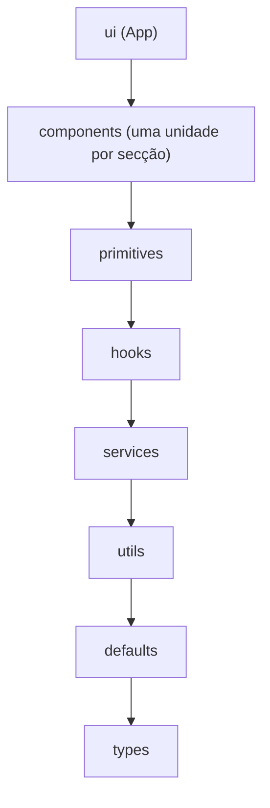

# SmartPatch

Página de pré-reserva da SmartPatch, uma garrafa térmica inteligente para canetas de insulina. Está em React e existe em seis línguas.

## Arquitetura

As dependências só apontam para baixo. O `dependency-cruiser` impõe esta ordem no CI. A ordem vive em `app/layers.json`.



Cada unidade de `components/` repete a regra com as pastas `types`, `defaults`, `utils`, `hooks` e `ui`. Duas unidades nunca se importam. O que partilham desce para uma camada de baixo ou chega por argumento.

```text
app/
├── services/frontend/
│   ├── src/              código (camadas acima)
│   ├── resources/        index.html e os textos em i18n/locales/<língua>.json
│   ├── scripts/          pré-renderização do build
│   └── tests/
└── tooling/              leitor do automation.config.yml e testes do pipeline
```

## Requisitos

- Node 22 ou superior.
- pnpm 10 (o `packageManager` de `app/package.json` fixa a versão).

## Configuração

1. Instala as dependências com `pnpm install` dentro de `app/`.
2. Define `SITE_URL` com o endereço público para o build. Vê `deployment/vercel/.env.example`.
3. Edita os textos em `app/services/frontend/resources/i18n/locales/`. Cada língua tem um ficheiro com as mesmas chaves.

Os URLs seguem o padrão `/<língua>/`: `/pt/`, `/en/`, `/es/`, `/fr/`, `/ru/` e `/zh/`. A raiz `/` escolhe a língua guardada ou a do browser e redireciona. As páginas por língua nunca redirecionam.

Os hooks, as verificações e os workflows ligam-se e desligam-se só em `automation.config.yml`.

## Deploy

Na Vercel, cria o projeto com estas definições:

1. Root Directory: `app`.
2. Build Command: `pnpm --filter @smartpatch/frontend build`.
3. Output Directory: `services/frontend/dist`.
4. Variável `SITE_URL` com o domínio final (sem barra no fim).

O build pré-renderiza uma página por língua, com `canonical`, `hreflang`, Open Graph e JSON-LD próprios. Gera também `sitemap.xml` e `robots.txt`.

## Operação

Comandos, dentro de `app/`:

- `pnpm dev`, `pnpm build`
- `pnpm lint`, `pnpm typecheck`, `pnpm test`
- `pnpm architecture` verifica as camadas e os ciclos.
- `pnpm test:tooling` verifica a estrutura do repositório e o `automation.config.yml`.

O CI corre em cada pull request:

- `ci`: lint, arquitetura, testes e build.
- `security`: procura segredos no histórico (gitleaks) e vulnerabilidades conhecidas nas dependências (Trivy). Corre também às segundas-feiras.
- `dependabot-automerge`: aprova e ativa o auto-merge dos pull requests do Dependabot, exceto os de versão maior.

Para o auto-merge funcionar, ativa estas definições no GitHub:

1. Settings, General: "Allow auto-merge".
2. Settings, Actions, General: "Allow GitHub Actions to create and approve pull requests".
3. Settings, Branches: protege o `main` e marca como obrigatórios os jobs `lint`, `architecture`, `test`, `build`, `secrets` e `vulnscan`. Sem isto o auto-merge junta logo, sem esperar pelo CI.
4. Settings, Code security: liga o secret scanning e o push protection.

## Limites conhecidos

- As traduções em espanhol, francês, russo e mandarim foram escritas sem revisão de falantes nativos. Revê sobretudo as frases de saúde.
- As páginas não têm imagem para partilha (`og:image`). O cartão do Twitter usa o formato `summary`.
- O `pnpm audit` aponta uma vulnerabilidade alta em `picomatch`, dentro do `dependency-cruiser`, sem versão corrigida. O Trivy ignora-a porque não há correção.
- O seletor de língua guarda a escolha no `localStorage`. Sem ele, a raiz usa a língua do browser.
- Os eventos de métricas personalizados exigem o plano Pro da Vercel.
